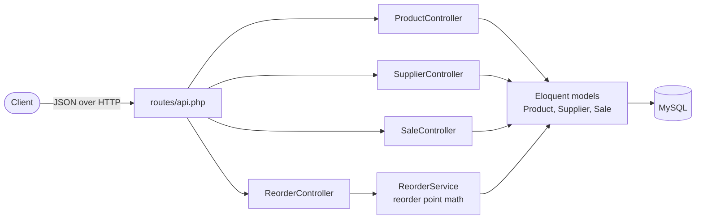
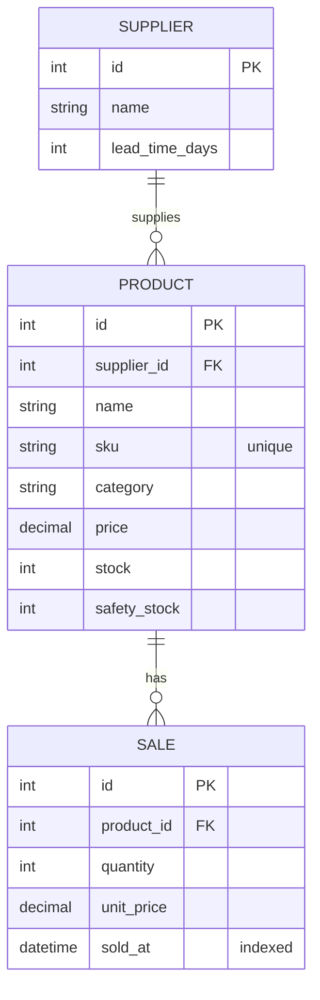

# RetailIQ


An inventory analytics API for small retail stores. It tracks products, suppliers and weekly sales, and tells the store owner which products to reorder **before** they run out, based on how fast each product sells and how long its supplier takes to deliver.

## The Problem

Small stores usually reorder by gut feeling. They either run out of their best sellers while waiting on a slow supplier, or they tie up cash in boxes of stock that barely moves. The fix is a reorder point: the stock level where you need to order now so the new stock arrives before you hit zero. RetailIQ calculates that for every product, using real sales history.

## How the Reorder Point Works

```
weekly average  = average units sold over the last 4 weeks
weeks of waiting = supplier lead time (days) / 7
reorder point   = ceil(weekly average × weeks of waiting + safety stock)
needs reorder   = current stock <= reorder point
```

For example, with the sample data:

| Product | Stock | Avg per week | Supplier lead time | Safety stock | Reorder point | Reorder? |
|---|---|---|---|---|---|---|
| Wireless Charger | 8 | 6.0 | 7 days | 4 | 10 | **Yes** |
| Lightning Cable | 12 | 10.0 | 10 days | 5 | 20 | **Yes** |
| Leather Case | 22 | 5.5 | 14 days | 6 | 17 | No |
| Phone Charger | 60 | 15.5 | 7 days | 5 | 21 | No |

`GET /api/reorder-suggestions` returns this analysis for every product, with the ones that need reordering first.

## Features

- REST API for products, suppliers and sales
- Reorder suggestions for every product, based on sales speed, supplier lead time and safety stock
- Sales filtering by product and by time window (for example, the last 2 weeks)
- Request validation on new products (unique SKU, valid supplier, no negative prices or stock)
- Seed data with 3 suppliers, 8 products and 8 weeks of sales, so the API is useful right after setup

## Tech Stack

| Layer | Technology |
|---|---|
| Backend | PHP 8.4, Laravel 13 |
| Database | MySQL 8 (Docker), SQLite for quick local runs |
| Auth (set up for upcoming user roles) | Laravel Sanctum |
| Frontend (next) | React dashboard |

## Architecture



### Database



## API Endpoints

| Method | Endpoint | What it does |
|---|---|---|
| GET | `/api/products` | List all products with their supplier |
| GET | `/api/products/{id}` | One product with its supplier |
| POST | `/api/products` | Add a product (validated) |
| GET | `/api/suppliers` | List suppliers with how many products each one supplies |
| GET | `/api/suppliers/{id}` | One supplier with its products |
| GET | `/api/sales` | List sales, newest first. Filters: `?product_id=3`, `?weeks=2` |
| GET | `/api/reorder-suggestions` | Reorder analysis for every product, items to reorder first |

## Key Decisions

- **The reorder math lives in its own service.** `ReorderService` holds the formula, and the controller only fetches products and returns the results. The math can be tested and reused (for example, by a future dashboard or a weekly email) without touching HTTP code.
- **Lead time belongs to the supplier, not the product.** Every product from the same supplier waits the same amount of time, so it's stored once on the `suppliers` table.
- **Safety stock is set per product.** A popular item can carry a bigger buffer than a slow one, instead of using one rule for the whole store.
- **Prices are stored on each sale.** `unit_price` is saved at the time of sale, so changing a product's price later doesn't rewrite past revenue.
- **`sold_at` is indexed.** Sales are always filtered and sorted by date, so the index keeps those queries fast as the table grows.
- **Validation happens before anything touches the database.** New products need a real supplier, a unique SKU and non-negative price and stock, otherwise the API returns a 422 with the reasons.

## Run It Locally

You need PHP 8.4+, Composer, and either Docker (for MySQL) or SQLite.

```bash
git clone https://github.com/manaswichowdary/retailIQ.git
cd retailIQ
composer install
cp .env.example .env
php artisan key:generate
```

**Quick start with SQLite** (the default in `.env.example`):

```bash
touch database/database.sqlite
php artisan migrate --seed
php artisan serve
```

**Or use MySQL in Docker:** run `docker compose up -d`, then set these in `.env` before migrating:

```
DB_CONNECTION=mysql
DB_HOST=127.0.0.1
DB_PORT=3306
DB_DATABASE=retailiq
DB_USERNAME=retailiq
DB_PASSWORD=secret
```

Then try it:

```bash
curl http://localhost:8000/api/reorder-suggestions
curl "http://localhost:8000/api/sales?weeks=2"
```

## What's Next

- React dashboard with sales charts and a reorder list
- Staff and manager roles (the `role` column and Sanctum are already in place)
- Feature tests for every endpoint and unit tests for `ReorderService`
